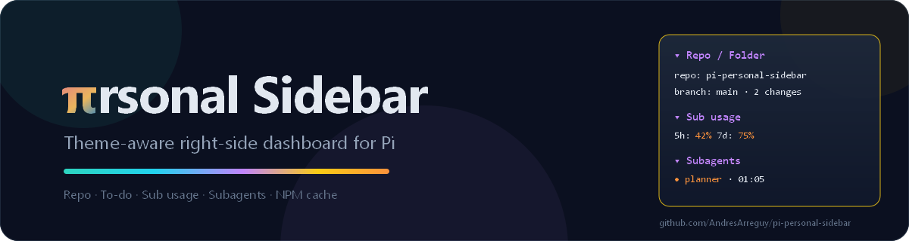

# pi-personal-sidebar

[Español](README.es.md) · [English](README.md)

<p align="center">
  
</p>

<p align="center">
  <a href="https://github.com/AndresArreguy/pi-personal-sidebar/stargazers">
    
  </a>
</p>

> ⭐ Si esta sidebar te sirve, [dejale una estrella al repo](https://github.com/AndresArreguy/pi-personal-sidebar). Ayuda a que otras personas de Pi lo encuentren.

[](https://pi.dev/packages)

Un **dashboard lateral derecho para Pi que sigue el theme activo**: repositorio,
tareas, uso de Command Code, subagentes corriendo y limpieza del cache de npm,
sin tapar el chat.

Pi no tiene una API nativa de split-pane, así que la extensión envuelve el layout
root de fullscreen en un `HStack` y reserva una columna fija a la derecha. El
transcript, el editor y el footer se reacomodan al ancho restante.

```text
┌────────────────────────────────┬──────────────────────┐
│ chat / transcript / editor     │ ▾ Repo / Carpeta     │
│                                │ ▾ To-do              │
│                                │ ▾ Sub usage       │
│                                │ ▾ Subagentes         │
│                                │ ▾ NPM cache          │
└────────────────────────────────┴──────────────────────┘
```

## Features

- **Repo / Carpeta** — nombre del repo, branch, cantidad de archivos modificados
  y ruta local.
- **To-do** — tareas de [`rpiv-todo`](https://www.npmjs.com/package/@juicesharp/rpiv-todo).
  Su overlay propio se oculta para que la lista aparezca una sola vez.
- **Sub usage** — barras de progreso para la cuota de 5 horas y semanal, uso
  del context window, tokens y costo de la sesión, más modelo y thinking
  actuales. La cuota refresca cada 60s; contexto/tokens cada 2s.
- **Subagentes** — llamadas activas a `run_agent` con agente, preview de la task
  y tiempo transcurrido.
- **NPM cache** — `[ Limpiar cache NPM ]` ejecuta `npm cache clean --force` y,
  si existe, `pnpm store prune`. Siempre pide confirmación.
- **Secciones colapsables** — títulos en bold con `▾ / ▸`. Se clickean con el
  mouse o se navegan con teclado.
- **Theme-aware** — sin colores hardcodeados. Ver [Integración con themes](#integración-con-themes).
- **UI bilingüe** — español/inglés, automático por defecto.

## Requisitos

- Pi **1.5.x** en fullscreen (el default).
- Node.js **22.6+**.
- Opcional: `@juicesharp/rpiv-todo` para la sección To-do.
- Opcional: login del provider `commandcode` (o `COMMAND_CODE_API_KEY` /
  `COMMANDCODE_API_KEY`) para las barras de cuota. Otros providers igual muestran
  contexto, tokens, modelo y thinking.

## Instalación

Desde GitHub:

```bash
pi install git:github.com/AndresArreguy/pi-personal-sidebar
```

Fijado a un tag:

```bash
pi install git:github.com/AndresArreguy/pi-personal-sidebar@v1.1.0
```

Desde un clon local:

```bash
git clone https://github.com/AndresArreguy/pi-personal-sidebar.git
cd pi-personal-sidebar
pi install .
```

Proveedor de tareas opcional:

```bash
pi install npm:@juicesharp/rpiv-todo
```

> Si antes copiaste `personal-sidebar.ts` en `~/.pi/agent/extensions/`, borralo
> antes de instalar este paquete. Cargar los dos crea dos wrappers de layout y
> dos sidebars.

Reiniciá Pi o corré:

```text
/reload
```

## Uso

```text
/sidebar                              ayuda
/sidebar toggle <git|todo|usage|agents|cache>
/sidebar focus                        foco de teclado (↑↓, Enter, Esc)
/sidebar hide | /sidebar show
/sidebar cache                        limpia el cache de npm/pnpm
/sidebar refresh                      refresca git, usage y tareas
/sidebar width <28-56>                cambia el ancho de la columna
/sidebar language [auto|es|en]        muestra o cambia el idioma
```

`Ctrl+Alt+B` muestra/oculta la sidebar. Al ocultarla, el chat recupera todo el
ancho.

### Mouse y teclado

- Click en el título de una sección para colapsarla/expandirla.
- Click en `[ Limpiar cache NPM ]` para ejecutar la limpieza.
- `/sidebar focus` y después `↑ / ↓`, `Enter`, `Esc` para uso 100% teclado.
- Al redimensionar la terminal, el chat y la sidebar se reacomodan.

## Integración con themes

La sidebar usa el theme activo de Pi; no trae colores propios. Un theme
personalizado se aplica automáticamente.

| Parte | Token / API del theme |
|---|---|
| Fondo del panel | default del terminal (igual que el chat) |
| Borde | `theme.getThinkingBorderColor(thinking)` — el mismo color que usa el borde del input del chat (amarillo en `high`) |
| Títulos | `mdHeading` |
| Texto | `text` |
| Porcentajes y nombres de agentes | `mdCode` |
| Fila seleccionada/enfocada | `selectedBg` |
| Barras de progreso | `success` / `warning` / `error` según porcentaje |
| Iconos de tareas | `success`, `accent`, `dim` |
| Errores | `warning` |

Si el theme activo no define un token, Pi usa su fallback normal. No hace falta
un theme específico para la sidebar.

## Configuración

Las preferencias viven en:

```text
~/.pi/agent/personal-sidebar.json
```

```json
{
  "width": 40,
  "hidden": false,
  "collapsed": [],
  "language": "auto"
}
```

- `width`: 28–56 columnas (default 40).
- `hidden`: lo togglea `Ctrl+Alt+B` o `/sidebar hide|show`.
- `collapsed`: ids de sección (`git`, `todo`, `usage`, `agents`, `cache`).
- `language`: `auto`, `es` o `en`.

Precedencia del idioma:

```text
PI_SIDEBAR_LANG  >  language en personal-sidebar.json  >  locale del sistema
```

El panel se oculta solo cuando la terminal mide menos de 100 columnas, para que
el chat conserve un ancho usable.

## Cómo funciona

1. En `session_start`, la extensión registra un widget ancla de altura cero para
   obtener la instancia TUI de Pi.
2. Envuelve el layout root actual en un `SidebarLayout` (`HStack`) con:
   - la UI original de Pi como columna izquierda que crece;
   - la sidebar como columna derecha de ancho fijo.
3. Parchea `tui.setLayoutRoot` para envolver también los roots futuros.
4. En `session_shutdown` restaura el root y el método originales.

La sidebar **no es un overlay**: reserva columnas reales y nunca tapa el
transcript.

## Desarrollo

```bash
git clone https://github.com/AndresArreguy/pi-personal-sidebar.git
cd pi-personal-sidebar
npm run check       # chequeo de sintaxis (no hay build)
pi install .        # carga el paquete local
```

Después editá `index.ts`, `i18n.ts` o `quota.ts` y corré `/reload` en Pi.

## Limitaciones

- Solo fullscreen. En regular mode (`tuiMode: "regular"`) avisa y no se activa.
- La integración de layout parchea `setLayoutRoot`. Si una versión futura de Pi
  cambia la API de fullscreen, puede requerir una actualización.
- El progreso de subagentes es agente + task + tiempo. `run_agent` no streamea la
  salida del hijo.
- Las barras de cuota dependen de la API de Command Code y del plan de la
  cuenta. Otros providers igual muestran contexto, tokens, modelo y thinking.

## Contribuir

Las contribuciones son bienvenidas. Leé [CONTRIBUTING.md](CONTRIBUTING.md) y el [Código de Conducta](CODE_OF_CONDUCT.md). Issues y PRs pueden ser en inglés o español. Reportes de seguridad: [SECURITY.md](SECURITY.md).

## ⭐ Apoyo

Si esta sidebar te sirve, dejale una estrella al repo. Ayuda a que otras personas de Pi lo encuentren.

[](https://github.com/AndresArreguy/pi-personal-sidebar/stargazers)

Issues y pull requests son bienvenidos.

## Créditos

Construido sobre [Pi](https://github.com/earendil-works/pi) por el equipo de Pi.

## Licencia

MIT © 2026 Andres Arreguy.
