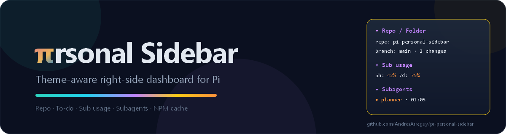

# pi-personal-sidebar

[English](README.md) · [Español](README.es.md)

<p align="center">
  
</p>

<p align="center">
  <a href="https://github.com/AndresArreguy/pi-personal-sidebar/stargazers">
    
  </a>
</p>

> ⭐ If this sidebar is useful, please [star the repo](https://github.com/AndresArreguy/pi-personal-sidebar). It helps other Pi users find it.

[](https://pi.dev/packages)

A **theme-aware right-side dashboard for Pi**: repository, todos, Command Code
usage, running subagents and one-click npm cache cleanup — without covering the
chat.

Pi has no native split-pane API, so the extension wraps Pi's fullscreen layout
root in an `HStack` and reserves a fixed right column. The transcript, editor
and footer reflow into the remaining width.

```text
┌────────────────────────────────┬──────────────────────┐
│ chat / transcript / editor     │ ▾ Repo / Folder      │
│                                │ ▾ To-do              │
│                                │ ▾ Sub usage       │
│                                │ ▾ Subagents          │
│                                │ ▾ NPM cache          │
└────────────────────────────────┴──────────────────────┘
```

## Features

- **Repo / Folder** — repository name, branch, dirty file count and local path.
- **To-do** — tasks from [`rpiv-todo`](https://www.npmjs.com/package/@juicesharp/rpiv-todo). Its own overlay is hidden so the list only appears once.
- **Sub usage** — progress bars for the 5-hour and weekly quota, context-window usage, session token totals and cost, plus the current model and thinking level. Quota refreshes every 60s; context/tokens every 2s.
- **Subagents** — active `run_agent` calls with agent name, task preview and elapsed time.
- **NPM cache** — `[ Clear NPM cache ]` runs `npm cache clean --force` and, when available, `pnpm store prune`. A confirmation dialog is always shown.
- **Collapsible sections** — bold titles with `▾ / ▸`. Click a title with the mouse, or focus the panel and use the keyboard.
- **Theme-aware** — no hardcoded colors. See [Theme integration](#theme-integration).
- **Bilingual UI** — Spanish/English, automatic by default.

## Requirements

- Pi **1.5.x** (fullscreen mode, the default).
- Node.js **22.6+**.
- Optional: `@juicesharp/rpiv-todo` for the To-do section.
- Optional: a `commandcode` provider login (or `COMMAND_CODE_API_KEY` /
  `COMMANDCODE_API_KEY`) for the quota bars. Other providers still show
  context, tokens, model and thinking.

## Install

From GitHub:

```bash
pi install git:github.com/AndresArreguy/pi-personal-sidebar
```

Pinned to a tag:

```bash
pi install git:github.com/AndresArreguy/pi-personal-sidebar@v1.1.0
```

From a local clone:

```bash
git clone https://github.com/AndresArreguy/pi-personal-sidebar.git
cd pi-personal-sidebar
pi install .
```

Optional todo provider:

```bash
pi install npm:@juicesharp/rpiv-todo
```

> If you previously copied `personal-sidebar.ts` into
> `~/.pi/agent/extensions/`, remove it before installing this package. Loading
> both would create two layout wrappers and two sidebars.

Restart Pi or run:

```text
/reload
```

## Usage

```text
/sidebar                              help
/sidebar toggle <git|todo|usage|agents|cache>
/sidebar focus                        keyboard focus (↑↓, Enter, Esc)
/sidebar hide | /sidebar show
/sidebar cache                        clear the npm/pnpm cache
/sidebar refresh                      refresh git, usage and todos
/sidebar width <28-56>                change the column width
/sidebar language [auto|es|en]        show or change the UI language
```

`Ctrl+Alt+B` toggles the sidebar. Hiding it gives the full width back to the
chat.

### Mouse and keyboard

- Click a section title to collapse or expand it.
- Click `[ Clear NPM cache ]` to run the cleanup.
- `/sidebar focus` then `↑ / ↓`, `Enter`, `Esc` for keyboard-only use.
- Dragging/resizing the terminal reflows the chat and the sidebar.

## Theme integration

The sidebar uses the active Pi theme; no colors are bundled. A custom theme
automatically applies to it.

| Part | Theme token / API |
|---|---|
| Panel background | terminal default (same as the chat) |
| Border | `theme.getThinkingBorderColor(thinking)` — the exact color Pi uses for the chat input border (yellow at `high`) |
| Section titles | `mdHeading` |
| Body text | `text` |
| Percentages and agent names | `mdCode` |
| Selected/focused row | `selectedBg` |
| Progress bars | `success` / `warning` / `error` by percentage |
| Todo icons | `success`, `accent`, `dim` |
| Errors | `warning` |

If the active theme does not define a token, Pi's normal fallback applies. No
sidebar-specific theme is required.

## Configuration

Preferences live in:

```text
~/.pi/agent/personal-sidebar.json
```

```json
{
  "width": 40,
  "hidden": false,
  "collapsed": [],
  "language": "auto"
}
```

- `width`: 28–56 columns (default 40).
- `hidden`: toggled by `Ctrl+Alt+B` or `/sidebar hide|show`.
- `collapsed`: section ids (`git`, `todo`, `usage`, `agents`, `cache`).
- `language`: `auto`, `es` or `en`.

Language precedence:

```text
PI_SIDEBAR_LANG  >  language in personal-sidebar.json  >  system locale
```

The panel hides itself when the terminal is narrower than 100 columns, so the
chat keeps a usable width.

## How it works

1. On `session_start`, the extension registers a zero-height anchor widget to
   obtain Pi's TUI instance.
2. It wraps the current layout root in a `SidebarLayout` (`HStack`) with:
   - the original Pi UI as the growing left column;
   - the sidebar as a fixed-width right column.
3. It patches `tui.setLayoutRoot` so future roots are wrapped too.
4. On `session_shutdown` it restores the original root and method.

The sidebar is **not an overlay**; it reserves real columns and never covers the
transcript.

## Development

```bash
git clone https://github.com/AndresArreguy/pi-personal-sidebar.git
cd pi-personal-sidebar
npm run check       # syntax check (no build step)
pi install .        # load the local package
```

Then edit `index.ts`, `i18n.ts` or `quota.ts` and run `/reload` in Pi.

## Limitations

- Fullscreen mode only. Regular mode (`tuiMode: "regular"`) shows a warning and
  leaves the sidebar off.
- The layout integration patches `setLayoutRoot`. A future Pi release that
  changes the fullscreen layout API may require an update.
- Subagent progress is agent + task + elapsed time. Live child output is not
  streamed by `run_agent`.
- Quota bars depend on the Command Code API and the current account plan. Other
  providers still show context, tokens, model and thinking.

## ⭐ Support

If this sidebar is useful, please star the repo. It helps other Pi users find it.

[](https://github.com/AndresArreguy/pi-personal-sidebar/stargazers)

Issues and pull requests are welcome.

## Credits

Built on [Pi](https://github.com/earendil-works/pi) by the Pi team.

## License

MIT © 2026 Andres Arreguy.
